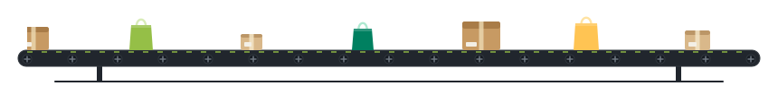

## Hi, I'm Lucas, connect with me 🤝

  
  

## About Me

- 🛍️ Shopify Developer building and migrating stores
- 🎨 Front end: custom themes and storefront UI
- ⚙️ Back end: Custom and third-party apps setup
- 🎓 Graduating in **December 2026**
- 🤝 Open to collaborating on Shopify stores and apps

## Stats 📊

  
     
 
